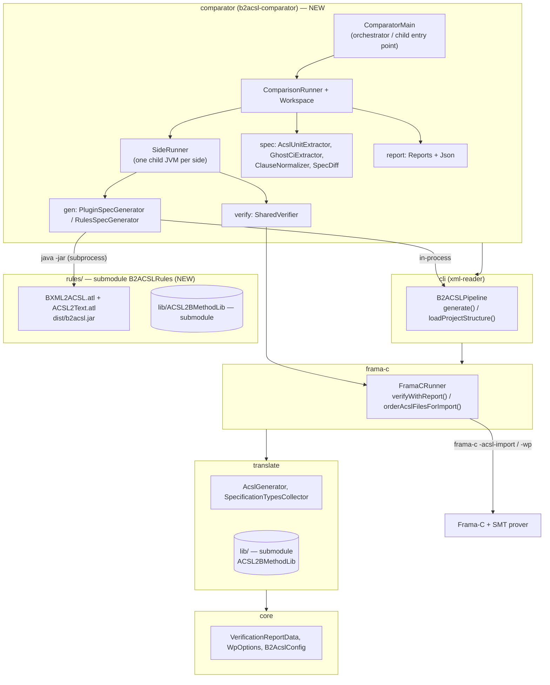

# comparator: B2ACSLPlugin × B2ACSLRules

The `comparator` module compares the two B → ACSL translators for the same B project. It looks at two things:

1. **The specifications.** It compares the generated files structurally (units and clauses) and also as text.
2. **The verification results.** It runs Frama-C/WP on each specification and compares the proved and total goals, failures, timeouts and smoke tests, for the whole run and per function.

The translators are:

- **B2ACSLPlugin**, this repository, which translates in Java.
- **B2ACSLRules**, the git submodule [`rules/`](../rules), which translates with ATL model transformations: BXML → ACSLImporter metamodel → text.

All results are written as JSON.

The comparison is designed so that **the translator is the only variable**. Both sides get:

- the same BXML input;
- the same Atelier B C code;
- the same B2ACSLLib (the plugin's copy, `translate/src/main/resources/lib/B2ACSLLib`);
- the same `-acsl-import` order, derived from the SEES/IMPORTS graphs;
- the same `FramaCRunner`;
- the same WP options.

## Modules



## How a run works

`ComparisonRunner.run(example)` goes through these steps:

1. **Workspace.** Creates `<out>/<example>/plugin/` and `<out>/<example>/rules/`. Each one gets its own copy of `bdp/**/*.bxml` and `lang/c/*.c,*.h`, and nothing generated by earlier runs is copied. Separate folders are needed because both tools write files with the same names (`connection.acsl`, `ghost_operations.ci`, `merged_code.c`, ...).
2. **Plugin side**, in a child JVM. `B2ACSLPipeline.generate()` translates the project, then `FramaCRunner.orderAcslFilesForImport()` computes the `-acsl-import` order, exactly as `runFramaC` does in a normal run.
3. **Rules side**, in a child JVM:
   - runs `java -jar rules/dist/b2acsl.jar <bdp> <lang/c>` as a subprocess, which keeps the OSGi/EMF/ATL classes off the plugin's classpath;
   - collects the `AVISO:` warnings, which mark B constructs the ATL rules do not support yet;
   - copies the B2ACSLLib into `lang/c/import/`;
   - writes `specification_types.txt`;
   - computes the same import order from the same BXML graphs.
4. **Snapshot.** Each side copies its specification files to `<side>/spec/` before verification, because verification may rename symbols in place.
5. **Verification.** `SharedVerifier` builds one set of `WpOptions` and calls `FramaCRunner.verifyWithReport(...)`. That runs `-acsl-import` → `merged_code.c` post-processing → `-wp`, and the structured result is written to `<side>/side-result.json`.
6. **Comparison.** `SpecDiff` compares the two snapshots and `report.json` is written. After each example, `summary.json` is rewritten.

Each side runs in its own JVM, just as the plugin does in a normal run, so static state of the translator never leaks between sides or examples. The sides run one after the other, so the provers never compete for CPU.

A failure on one side never aborts anything. It becomes a `status` and the other side and the batch keep going.

| stage | statuses |
|---|---|
| generation | `OK`, `NO_C_FILES`, `GENERATION_ERROR`, `TRANSLATION_ERROR`, `IO_ERROR`, `TIMEOUT`, `NOT_AVAILABLE`, `ERROR` |
| verification | `COMPLETED`, `IMPORT_ERROR`, `IMPORT_TIMEOUT`, `WP_ERROR`, `WP_TIMEOUT`, `NO_C_FILES`, `NO_ACSL_FILES`, `SKIPPED`, `ERROR` |

## Structural comparison

All files of one side are read and split into **units**, each with a stable key. The units of all files are merged before comparing, because the plugin spreads content across auxiliary files (`_M_lib_includes.acsl`, `M_tuple_types.acsl`, ...).

| key | compared content |
|---|---|
| `include:import/set_functions/card.acsl` | presence |
| `logic:ss`, `predicate:AddRunner_invariant_1`, `axiom:…`, `lemma:…`, `type:…` | the declaration |
| `axiomatic:AddRunner_variables` | which declarations it groups (the declarations themselves are their own units) |
| `function:AddRunner__Add` | one clause per statement, e.g. `requires …`, `[at loop 1] loop invariant …`, `[at return] assert …` |
| `ghost-var:…`, `ghost-fn:…`, `ghost-axiomatic:…`, … | from `ghost_operations.ci`: ghost globals, ghost functions (contract + signature), annotations |

Clauses are matched on a canonical form. The canonical form:

- removes comments;
- keeps a space only between two identifiers;
- drops parentheses that wrap a whole clause body;
- alpha-renames the variables bound by `\forall`/`\exists`/`\lambda`/`\let` (`_b0`, `_b1`, ...).

Each unit is then `EQUAL`, `DIFFERENT`, `ONLY_PLUGIN` or `ONLY_RULES`. Reports show clauses in their original form, with whitespace collapsed.

A whitespace-normalized unified diff of the files with the same name is kept in `spec.textDiff` for context.

## Usage

```bash
git submodule update --init --recursive
make build-rules                  # rules/dist/b2acsl.jar (needs the Eclipse ATL/EMF jars, see rules/README.md)
mvn -q -DskipTests package        # comparator/target/b2acsl-comparator-0.1.0-all.jar

make compare COMPARE_ARGS="--example AddRunner"
make compare COMPARE_ARGS="--all --timeout 10"
java -jar comparator/target/b2acsl-comparator-0.1.0-all.jar --help
```

Options:

| option | default | |
|---|---|---|
| `--example NAME` (repeatable) / `--all` | | which projects under `--examples-dir` to compare |
| `--examples-dir DIR` | `examples` | |
| `--out DIR` | `comparator-out/<timestamp>` | must not exist or must be empty |
| `--rules-jar FILE` | `rules/dist/b2acsl.jar` | |
| `--lib-dir DIR` | `translate/src/main/resources/lib/B2ACSLLib` | |
| `--prover`, `--timeout`, `--function-timeout` | `CVC5`, `10`, `600` | |
| `--whole-file` | off (one WP run per operation) | |
| `--no-verify` | off | |
| `--rules-timeout N` | `300` | |

Smoke tests, counterexamples, goal splitting and loop simplification follow the plugin's `-Db2acsl.wp.*` properties. Those properties are forwarded to both sides.

## Output

```
<out>/
├── summary.json                  one row per example (statuses, spec counts, proved/total per side)
└── <example>/
    ├── report.json               config + commits, generation, spec (units, textDiff, filesOnlyIn), verification (per function)
    ├── plugin/  rules/
    │   ├── bdp/  lang/c/         isolated workspace (merged_code.c, .frama-c/ of that side)
    │   ├── spec/                 generated specification, before verification
    │   ├── side-result.json      that side's generation + verification
    │   └── run.log               full log of the side (translation, Frama-C, WP)
```

`report.json` → `config.commits` records the revision of every component: plugin, rules, the plugin's B2ACSLLib and the rules' B2ACSLLib. A warning is added when the two library revisions differ.

## Threats to validity

- **Shared post-processing.** The 16 `merged_code.c` post-processing stages of `FramaCRunner` were written for the plugin's output: ghost patterns, the `dummy_` prefix, and so on. B2ACSLRules mimics that output on purpose and already depended on these stages before this module existed. Still, a difference in WP results may come from a stage that does not recognize a form produced by the rules translator, rather than from the meaning of the specification. Inspect `<side>/lang/c/merged_code.c` in that case.
- **Library include table.** The ATL rules choose which library files to include from a hand-written table (`libTable` in `BXML2ACSL.atl`). That table follows B2ACSLRules' own copy of the library, not the plugin's.
- **Fresh runs.** Every workspace starts empty. So the plugin side shows how the plugin behaves on a first run, without `.acsl` files left in `lang/c` by an earlier run.
